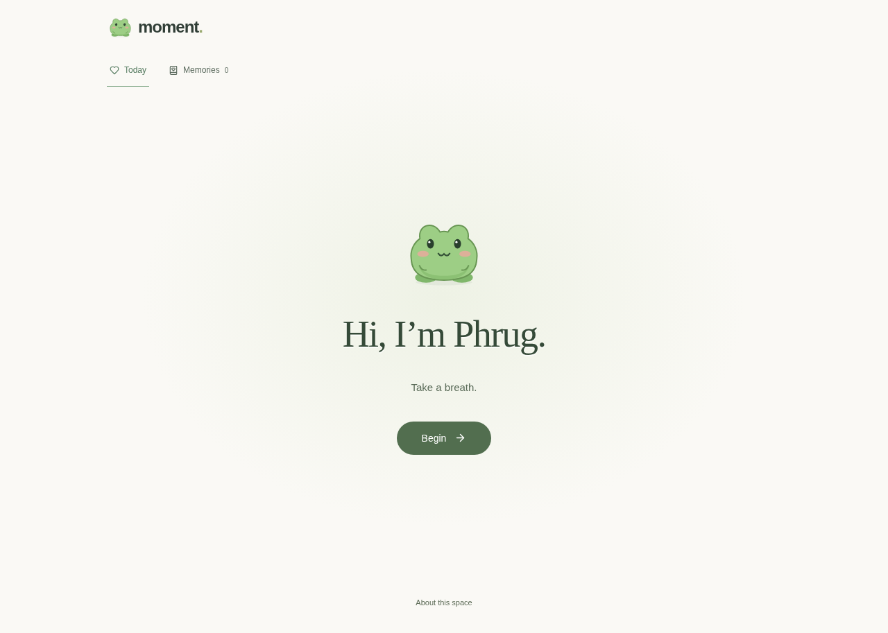

# Moment 🐸

**A journaling companion that picks up where you left off.**

Moment is a mobile-first product prototype for people who find traditional journaling intimidating or difficult to sustain. Instead of requiring daily streaks or forcing a blank-page experience, Moment offers optional starting prompts, low-pressure mood check-ins, persistent memories, and personalized follow-ups from Phrug, a friendly frog.

## Source
[GitHub: jomejom/moments](https://github.com/jomejom/moments)

## Demo
[Open Moment](https://moments-nine-pi.vercel.app/). On the Today page, open **About this space** and select **Try two fictional demo entries** to explore Phrug's follow-up experience without entering personal information.

## Guided experience


Returning users check in with their mood before choosing a previous-entry follow-up or a new topic. [View the mobile nudge screen](docs/returning-mobile.png).

## Product hypothesis
A personalized invitation to revisit something you've previously written may be more useful than an arbitrary daily streak. This is **a hypothesis, not a validated retention outcome**.

## Implemented features
- One prompt at a time: Phrug’s greeting → optional mood → topic choice → writing → saved confirmation
- Returning users see a previous-entry nudge after the mood step, with equal access to writing something new
- Optional starting points tucked behind a disclosure, plus Back navigation that preserves in-session drafts
- Browser-local persistence (localStorage); reload and entries remain on that device
- Memories list and entry detail; revisit tags and entry deletion
- Phrug's deterministic follow-up suggestions derived from stored reflections, prioritizing entries explicitly marked for later
- Dismiss or switch follow-up prompts
- Fictional demo entries to let reviewers test the loop
- Responsive layout, no registration or API key needed

## What is deliberately not built
- No LLM calls: context-aware follow-ups use a transparent, simple keyword-and-template heuristic; they are **not AI-generated**.
- No backend, authentication, cross-device sync, notifications, streaks, or claims of clinical coaching.
- No empirical evidence of increased retention yet.

## Run locally
```bash
npm install
npm run dev
```
Open http://localhost:3000.

## Validate
1. Open Today. Phrug greets you; select **Begin**.
2. Choose a feeling and **Continue**, or **Skip**.
3. Select **Start writing** or open **A little help**.
4. Write an entry, optionally select **Revisit this later**, and save.
5. Reload, greet Phrug and complete the mood step: a nudge based on your saved entry appears.
6. Choose **Stay with this** to respond, or **Something new** for a fresh topic.
7. Save and **My memories** to inspect the entries and response context.
8. On the nudge step, open **More** to switch memories or dismiss one. Use the fictional demos from About this space or empty Memories to explore without private information.

## Privacy
Journal entries are stored **only in the browser's localStorage** on the current device. They are not sent to an AI service. Clearing browser data removes entries. Do not enter sensitive information in a shared demo browser. The public deployed website serves code but does not make locally stored journal entries public.

## Next experiments
- Compare contextual vs generic follow-up prompts with consenting test users.
- Track opt-in, prompt acceptance, and return-to-reflect (without collecting raw journal content by default).
- Explore permission-based AI prompting with privacy controls and server-held API keys.

## Tech
Next.js (App Router), React, TypeScript, CSS, Lucide.

## Development
Built as an early portfolio prototype with AI-assisted coding. Describe implemented features accurately, and distinguish design hypotheses from measured outcomes.

## Regression checks
`npm run lint` runs TypeScript checking (`tsc --noEmit`), not ESLint. Run `npm run build` for the production build.

The browser checks use fictional text and an isolated browser context:
```bash
npx playwright install chromium
npm run dev
# In another terminal:
npm run test:e2e
npm run test:a11y
```
Set `BASE_URL` to test another local server. If using an existing Chromium installation, set `PLAYWRIGHT_CHROMIUM_EXECUTABLE_PATH` to its executable path. Journey screenshots are written to ignored `test-results/`.

The journey check covers first-time and returning guided flows, choosing a new topic or a previous-entry response, optional mood selection/skipping, Back navigation, saving/reloading, follow-up responses and source context, Memories, revisit tags, switching/dismissal, deletion/reset, demos, keyboard dialog behavior, draft protection, invalid stored data and storage write failures. It checks horizontal overflow at 320, 375, 768 and 1024 pixels. The accessibility check runs axe WCAG 2 A/AA and 2.1 AA rules across all guided steps, optional prompt controls, Memories and the entry dialog; automated checks do not replace screen-reader or real-device testing.

Unreadable stored entries are left untouched and changes are blocked rather than silently replacing data. Memories offers an explicitly confirmed local reset. Failed writes retain the current draft; unsaved drafts are not persisted across reloads.

`package-lock.json` records the tested dependencies. A PostCSS 8.5.33 override replaces Next.js's older transitive version without a Next.js major upgrade; recheck this override during future Next.js updates.
